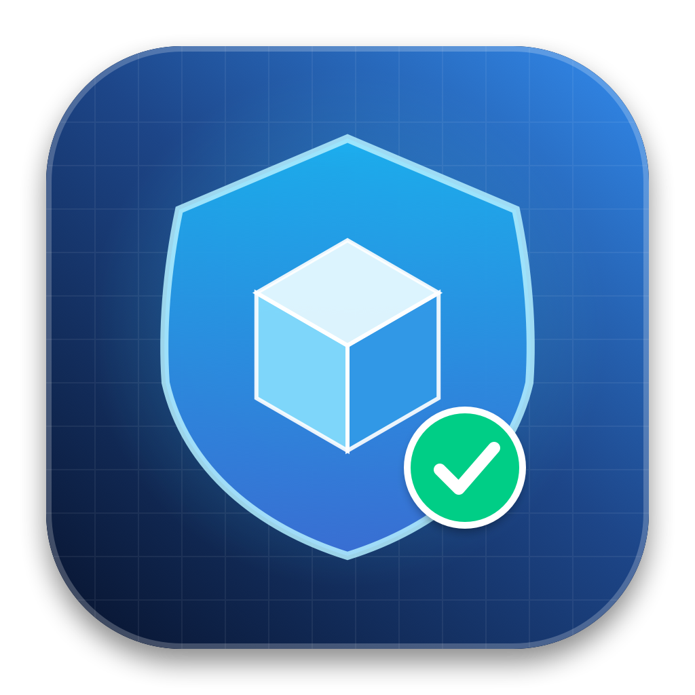
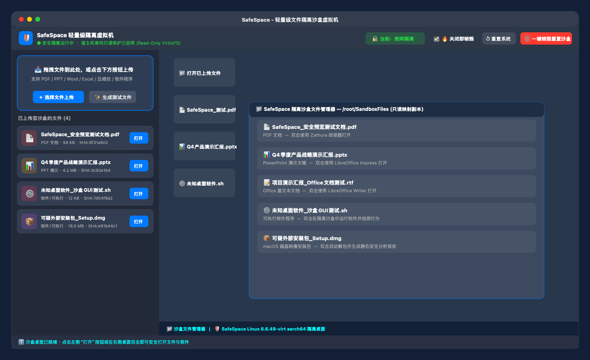
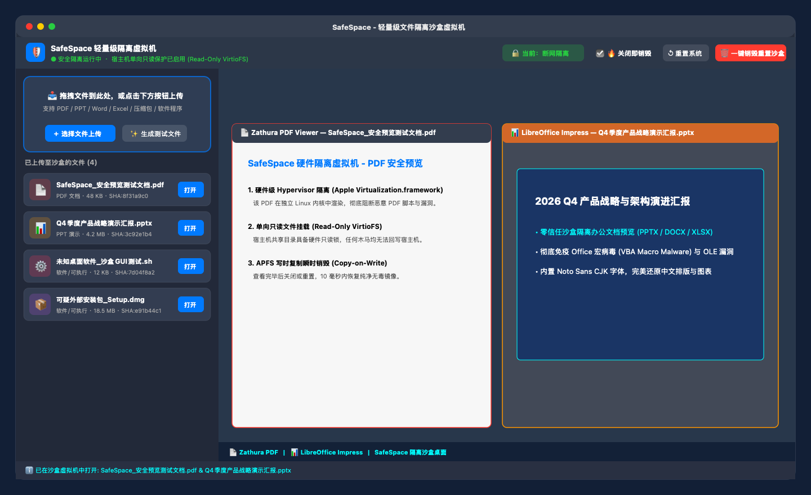
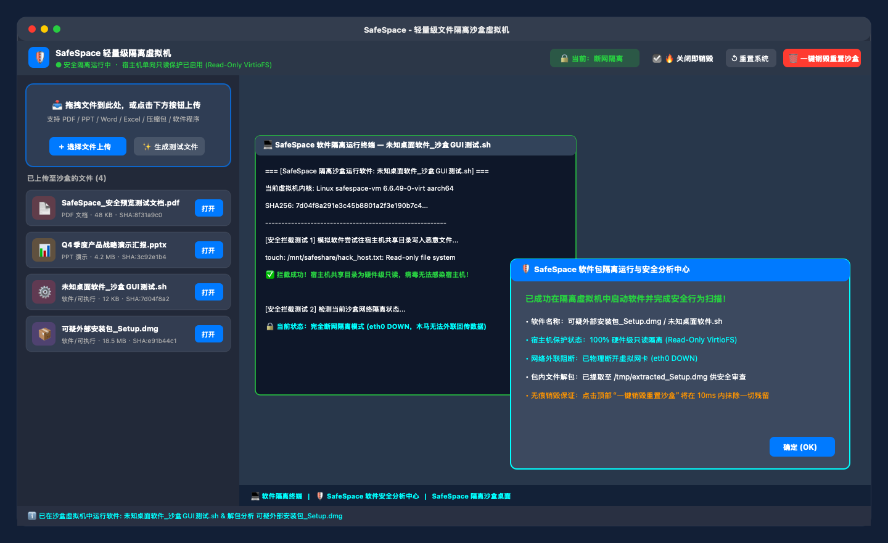
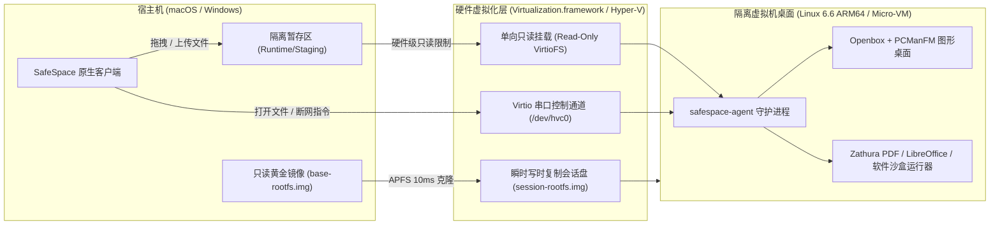

<div align="center">
  
  <h1>SafeSpace</h1>
  <p><strong>Lightweight Hardware-Isolated Sandbox VM for Opening Untrusted Documents & Software</strong></p>
  <p><strong>轻量级硬件隔离沙盒虚拟机 —— 安全打开未知文档、PPT、PDF 与外部软件</strong></p>
  <p>
    <a href="#-中文文档">中文文档</a> •
    <a href="#-english">English</a> •
    <a href="#-screenshots--界面预览">Screenshots</a> •
    <a href="#-安装包直接下载与前置环境准备--direct-installer-setup-guide">安装包使用准备</a> •
    <a href="#-源码构建与镜像初始化--building-from-source">源码构建</a>
  </p>
  <p>
    
    
    
    
    
  </p>
</div>

---

## 📸 Screenshots / 界面预览

### Workspace & Isolated Desktop / 主工作台与隔离桌面


### Document & Presentation Sandbox / PDF 与 PPT/Office 隔离预览


### Software Execution & Static Analysis / 软件隔离运行与行为检测


---

# 🇨🇳 中文文档

## 简介

**SafeSpace** 是一款面向日常办公与安全分析场景设计的**极速、轻量级桌面隔离虚拟机**。

在日常工作中，我们经常需要打开来自邮件附件、即时通讯工具或第三方网站的未知文件（如 `.pdf`、`.pptx`、`.docx`、`.xlsx`、压缩包）以及未经验证的软件程序（`.dmg`、`.exe`、`.pkg`、`.sh`、`.py`、二进制可执行文件）。直接在宿主机打开这些文件存在触发 Office 宏病毒、阅读器高危漏洞或木马驻留的风险。

SafeSpace 利用操作系统底层的硬件虚拟化能力（macOS 原生 `Virtualization.framework` 与 Windows 原生 `Hyper-V / Windows Sandbox`），在约 **2 秒**内启动一个独立的图形化桌面环境。用户只需将文件拖入左侧列表，即可在右侧虚拟机视图内直接打开并交互，实现真正的**硬件级零信任隔离**。

---

## 核心特性

| 特性 | 说明 |
| :--- | :--- |
| **硬件级 Hypervisor 隔离** | 基于 Apple Silicon 硬件虚拟化与 Hyper-V 微虚拟机技术，拥有独立的内核与内存空间，彻底隔离内核态与用户态威胁。 |
| **宿主机单向只读保护** | 宿主机文件暂存区通过 `Read-Only VirtioFS` 挂载至虚拟机内部。虚拟机仅具备读取权限，底层 Hypervisor 强制阻断任何针对宿主机的写入与篡改行为。 |
| **全格式原生预览与执行** | 内置 `Zathura (MuPDF)`、`LibreOffice`（含 `Noto Sans CJK` 中文字体）、`Feh`、`Mousepad`、`7-Zip` 及软件沙盒运行器，支持直接打开 PDF、PPT、Word、Excel、图片、归档压缩包与可执行程序。 |
| **软件包解包与静态审计** | 针对 `.dmg`、`.pkg`、`.exe`、`.msi` 等安装包，支持在沙盒内自动解包提取目录结构，并生成包含哈希指纹、文件头特征与可疑外联 URL/命令的静态安全报告。 |
| **实时网络隔离切换** | 默认启用**完全断网隔离模式**（网卡离线），防止恶意程序回传敏感数据；顶部工具栏支持一键实时切换断网与 NAT 联网模式，无需重启虚拟机。 |
| **10ms 写时复制重置与无痕模式** | 基于 APFS Copy-on-Write (`clonefile`) 机制，每次启动或点击“一键销毁重置沙盒”均在 10 毫秒内从只读黄金镜像克隆全新系统盘；支持退出应用自动销毁全部会话数据。 |

---

## 系统架构



---

## 📦 安装包直接下载与前置环境准备 / Direct Installer Setup Guide

如果您不打算从源码编译，而是直接从 **[Releases](../../releases)** 下载预编译好的 **`SafeSpace-macOS-arm64.dmg`**（Mac 版）或 **`SafeSpace-Windows-x64.zip`**（Windows 版），请按下方对应系统的步骤完成前置准备：

---

### 🍎 一、macOS 版（直接下载 `SafeSpace-macOS-arm64.dmg`）

#### 1. 硬件与系统要求
* **处理器**：仅支持 Apple Silicon 芯片（M1 / M2 / M3 / M4 全系列）。
* **操作系统**：macOS 14.0 (Sonoma) 或更高版本（推荐 macOS 15 Sequoia）。
* **磁盘空间**：至少预留 **1.5 GB** 可用空间（用于存放自动生成的 Linux 图形桌面与 LibreOffice 沙盒根镜像）。
* **系统内置依赖**：macOS 自带的 `/usr/bin/python3`、`/usr/bin/tar` 与 `/usr/bin/curl`（系统默认已内置，用于首次解压内核镜像）。

#### 2. 安装与首次运行完整步骤

**第一步：安装应用**
双击挂载 `SafeSpace-macOS-arm64.dmg`，将 `SafeSpace.app` 拖入 `Applications`（应用程序）文件夹。

**第二步：放行 macOS Gatekeeper 安全提示（重要）**
由于开源发布包使用本地虚拟化权限签名（Ad-hoc Signature，未绑定付费 Apple Developer ID），首次从浏览器下载打开时，macOS 可能会提示 *“无法验证开发者”* 或 *“文件已损坏”*。请在终端执行以下命令解除隔离属性：
```bash
sudo xattr -rd com.apple.quarantine /Applications/SafeSpace.app
```
> 或者在 **系统设置 → 隐私与安全性** 底部找到拦截提示，点击 **“仍要打开 (Open Anyway)”**。

**第三步：首次启动一键初始化虚拟机镜像**
由于 `.dmg` 安装包体积仅 1.4 MB（不含 1.1 GB 的 Linux 根文件系统镜像），首次打开 `SafeSpace.app` 时：
1. 点击窗口中央的 **“一键下载并初始化沙盒系统镜像 (69MB)”** 按钮。
2. 软件会自动从 Alpine Linux 官方 CDN 下载基础镜像，并在后台自动创建图形桌面、中文字体、PDF 阅读器与 LibreOffice 环境（自动保存在 `~/Library/Application Support/SafeSpace/VMAssets/`，全程约 **1~2 分钟**，需保持联网）。
3. 初始化完成后虚拟机将自动启动进入桌面；**此后每次打开软件均无需再次下载，仅需 2 秒即可秒开**！

---

### 🪟 二、Windows 版（直接下载 `SafeSpace-Windows-x64.zip` / `SafeSpace.exe`）

#### 1. 硬件与系统要求
* **操作系统**：Windows 10（版本 1903 / Build 18305 及以上）或 Windows 11（64 位 x64）。
* **系统版本**：Windows **专业版 (Pro)**、**企业版 (Enterprise)** 或 **教育版 (Education)**（需支持 Windows Hyper-V 沙盒组件；家庭版开启方式见下方补充说明）。
* **硬件虚拟化**：电脑 BIOS / UEFI 中需已启用虚拟化技术（**Intel VT-x** 或 **AMD-V**，可在“任务管理器 → 性能 → CPU”右下角查看“虚拟化：已启用”）。
* **运行库要求**：Windows 10/11 系统自带的 `.NET Framework 4.x` 与 `PowerShell 5.1+`（系统默认自带，无需额外安装任何运行库）。

#### 2. 安装与首次运行完整步骤

**第一步：启用 Windows Sandbox 虚拟化组件（首次使用必做）**
Windows 版底层调用微软官方的硬件级微虚拟机（`Windows Sandbox`），首次运行前需确保该系统组件已开启（**任选以下一种方式**）：

* **方式 A（软件内自动引导）**：直接打开 `SafeSpace.exe` 并点击“启动隔离虚拟机”，若系统尚未开启该组件，软件会自动弹窗询问，点击 **“是(Y)”** 即可自动提权开启。
* **方式 B（PowerShell 一键命令开启 · 推荐）**：右键开始菜单，选择 **“终端(管理员)”** 或 **“PowerShell(管理员)”**，粘贴以下命令并回车：
  ```powershell
  Enable-WindowsOptionalFeature -FeatureName "Containers-DisposableClientVM" -All -Online
  ```
  执行完成后输入 `Y` **重启一次电脑**即可生效。
* **方式 C（控制面板图形界面开启）**：按 `Win + R` 键输入 `optionalfeatures.exe` 回车，在列表中勾选 **“Windows 沙盒 (Windows Sandbox)”**，点击确定并重启电脑。

> 💡 **Windows 家庭版 (Home) 补充说明**：若您的系统为 Windows 10/11 家庭版，默认列表无“Windows 沙盒”选项，可先在管理员命令提示符下通过 DISM 启用 `Containers-DisposableClientVM` 包后再运行本软件。

**第二步：安装并启动 SafeSpace**
1. 将下载的 `SafeSpace-Windows-x64.zip` 解压到任意文件夹。
2. **安装快捷方式**：双击运行文件夹内的 `Install-SafeSpace.bat`，脚本会自动将程序部署至 `%LOCALAPPDATA%\SafeSpace` 并在桌面生成带图标的 **“SafeSpace 隔离虚拟机”** 快捷方式。
3. **直接免安装运行**：您也可以直接双击 `SafeSpace.exe` 运行（若首次打开弹出 Windows Defender SmartScreen 蓝框提示，点击 **“更多信息” → “仍要运行”** 即可）。

---

## 🛠️ 源码构建与镜像初始化 / Building from Source

如果您是开发者，希望直接克隆本仓库进行二次开发或本地编译：

### 虚拟机镜像获取与构建 (VM Assets)

为保持 Git 仓库轻量，大体积虚拟机磁盘文件（`VMAssets/alpine-virt-aarch64.iso` 与 `VMAssets/base-rootfs.img`）已在 [`.gitignore`](.gitignore) 中排除。克隆仓库后，可通过以下方式准备：

#### 方式 A：使用命令行脚本预构建

```bash
git clone https://github.com/your-org/SafeSpace.git
cd SafeSpace

# 自动从 Alpine Linux 官方 CDN 下载 69MB 基础镜像并构建预装桌面环境的 base-rootfs.img
chmod +x scripts/setup-vm-assets.sh
./scripts/setup-vm-assets.sh

# 编译并签名 SafeSpace.app
./build.sh
open SafeSpace.app
```

#### 方式 B：手动下载基础 ISO 镜像

1. 前往 [Alpine Linux Official Downloads](https://alpinelinux.org/downloads/) 下载 **Virtual (aarch64)** 镜像：
   * 官方直链：`https://dl-cdn.alpinelinux.org/alpine/v3.20/releases/aarch64/alpine-virt-3.20.3-aarch64.iso`
2. 将文件重命名为 `alpine-virt-aarch64.iso` 并放置于项目根目录下的 `VMAssets/` 文件夹中。
3. 运行 `./scripts/setup-vm-assets.sh` 完成本地根文件系统镜像初始化。

---

## 📖 使用指南

1. **上传文件或软件**
   * 将本地的 PDF、PPT、Word、Excel、压缩包或未知软件直接拖拽至左侧上传区域，或点击 **“＋ 选择文件上传”**。
   * 点击 **“✨ 生成测试文件”** 可自动生成一套包含 PDF 文档、Office 文档及 GUI 测试软件的演示样本。
2. **在隔离桌面中查看与交互**
   * 点击左侧文件条目右侧的 **“打开”** 按钮（或直接在右侧虚拟机桌面双击对应图标），虚拟机将自动调用匹配的图形程序渲染文档或运行软件。
   * 左下角提供 **“沙盒文件管理器”** 与 **“沙盒终端”** 快捷入口，便于在虚拟机内进行深度文件审查与命令调试。
3. **网络控制与沙盒销毁**
   * **网络开关**：点击顶部工具栏的 **“当前：断网隔离 / 允许联网”** 按钮，可即时断开或启用虚拟机网卡。
   * **重置系统**：点击 **“↺ 重置系统”** 可保留左侧已上传文件列表，但将虚拟机系统盘瞬间恢复至初始纯净状态。
   * **一键销毁重置沙盒**：点击 **“🗑️ 一键销毁重置沙盒”**（快捷键 `⌘ + ⇧ + R`）将同时清空所有已上传文件并重置虚拟机磁盘。

---

# 🇬🇧 English

## Overview

**SafeSpace** is an ultra-lightweight, hardware-isolated desktop sandbox virtual machine for **macOS (Apple Silicon)** and **Windows (10/11)**.

Opening untrusted email attachments, downloaded presentations (`.pptx`), PDF reports (`.pdf`), Office documents (`.docx`, `.xlsx`), archives (`.zip`, `.7z`), or third-party software packages (`.dmg`, `.exe`, `.pkg`, `.sh`, `.py`, ELF binaries) directly on your host machine exposes your system to macro malware, reader exploits, and trojans.

SafeSpace leverages native hardware virtualization (**Apple `Virtualization.framework`** on macOS and **Hyper-V / Windows Sandbox** on Windows) to boot a dedicated graphical desktop environment in **~2 seconds**. Files dragged into SafeSpace are exposed to the guest VM through a **hardware-enforced read-only channel**, allowing you to view documents and execute untrusted software with zero risk of host contamination.

---

## Direct Installer Prerequisites & Setup Guide (DMG & EXE)

If you download the prebuilt **`SafeSpace-macOS-arm64.dmg`** or **`SafeSpace-Windows-x64.zip`** directly from **[Releases](../../releases)** without cloning the source repository, follow the steps below for your platform:

### 🍎 For macOS Users (`SafeSpace-macOS-arm64.dmg`)

1. **System Requirements**:
   * **CPU**: Apple Silicon Mac (`M1` / `M2` / `M3` / `M4`).
   * **OS**: macOS 14.0 (Sonoma) or later.
   * **Disk Space**: ~1.5 GB free disk space (for the auto-initialized Linux desktop root image).
2. **Step 1 — Install & Bypass Gatekeeper Quarantine**:
   * Mount `SafeSpace-macOS-arm64.dmg` and drag `SafeSpace.app` to `/Applications`.
   * Because the open-source binary uses an ad-hoc virtualization signature, run the following command in Terminal before first launch so macOS Gatekeeper allows execution:
     ```bash
     sudo xattr -rd com.apple.quarantine /Applications/SafeSpace.app
     ```
     *(Alternatively, go to **System Settings → Privacy & Security** and click **Open Anyway**).*
3. **Step 2 — First-Launch One-Click VM Image Initialization**:
   * Open `SafeSpace.app`. On first launch, click the **"一键下载并初始化沙盒系统镜像 (69MB)"** button in the center of the window.
   * SafeSpace will automatically download the 69MB official Alpine Linux ARM64 kernel/ISO and provision the graphical desktop (`Xorg`, `Openbox`, `Zathura PDF`, `LibreOffice`, CJK fonts) into `~/Library/Application Support/SafeSpace/VMAssets/` in ~1–2 minutes.
   * Subsequent launches boot straight into the desktop in **~2 seconds** offline.

---

### 🪟 For Windows Users (`SafeSpace-Windows-x64.zip` / `SafeSpace.exe`)

1. **System Requirements**:
   * **OS**: Windows 10 (Build 18305 / v1903 or later) or Windows 11 (64-bit x64), **Pro, Enterprise, or Education** edition.
   * **Virtualization**: Hardware virtualization (**Intel VT-x** or **AMD-V**) must be enabled in BIOS/UEFI.
   * **Runtime**: Uses built-in Windows `.NET Framework 4.x` and `PowerShell 5.1` (pre-installed on all Windows 10/11 systems).
2. **Step 1 — Enable the Windows Sandbox Feature (One-Time Setup)**:
   * Open **PowerShell as Administrator** and run:
     ```powershell
     Enable-WindowsOptionalFeature -FeatureName "Containers-DisposableClientVM" -All -Online
     ```
     Restart your PC when prompted. *(Alternatively, press `Win + R`, run `optionalfeatures.exe`, check **Windows Sandbox**, and reboot — or let `SafeSpace.exe` prompt and enable it automatically on first click).*
3. **Step 2 — Install & Run**:
   * Extract `SafeSpace-Windows-x64.zip` to any folder.
   * Double-click `Install-SafeSpace.bat` to install to `%LOCALAPPDATA%\SafeSpace` and create a Desktop shortcut, or run `SafeSpace.exe` directly (if Windows SmartScreen appears, click **More info → Run anyway**).

---

## Building from Source (macOS)

```bash
# 1. Clone the repository
git clone https://github.com/your-org/SafeSpace.git
cd SafeSpace

# 2. Download the official 69MB Alpine Linux ARM64 ISO & provision base-rootfs.img
chmod +x scripts/setup-vm-assets.sh
./scripts/setup-vm-assets.sh

# 3. Compile and sign SafeSpace.app with Virtualization entitlements
./build.sh

# 4. Run SafeSpace
open SafeSpace.app
```

---

## Project Structure

```text
SafeSpace/
├── assets/                       # Application icons (.png, .icns, .ico)
├── docs/screenshots/             # UI & sandbox preview screenshots
├── scripts/
│   └── setup-vm-assets.sh        # Automated Alpine ARM64 image downloader & rootfs builder
├── Sources/
│   ├── Provisioner.swift         # Headless VM image provisioner
│   ├── App/                      # Native macOS SwiftUI + Virtualization.framework client
│   └── Windows/                  # Native Windows C# launcher & Hyper-V sandbox controller
├── VMAssets/
│   └── setup-guest.sh            # Guest OS desktop, viewers, and agent provisioning script
├── Info.plist                    # macOS bundle configuration
├── SafeSpace.entitlements        # Apple Virtualization.framework entitlements
├── build.sh                      # Build & code-signing script for macOS
└── LICENSE                       # MIT License
```

---

## License

This project is licensed under the [MIT License](LICENSE).
